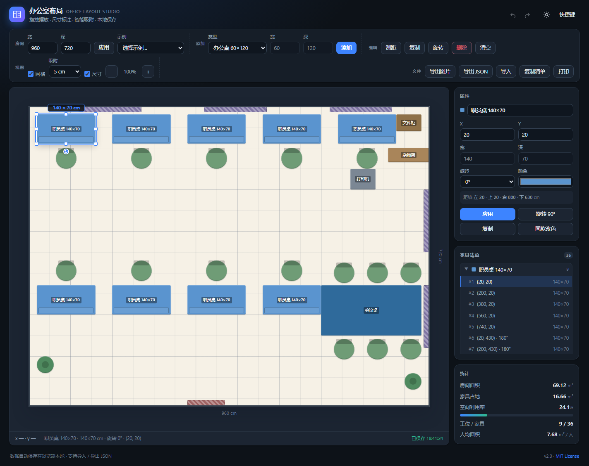
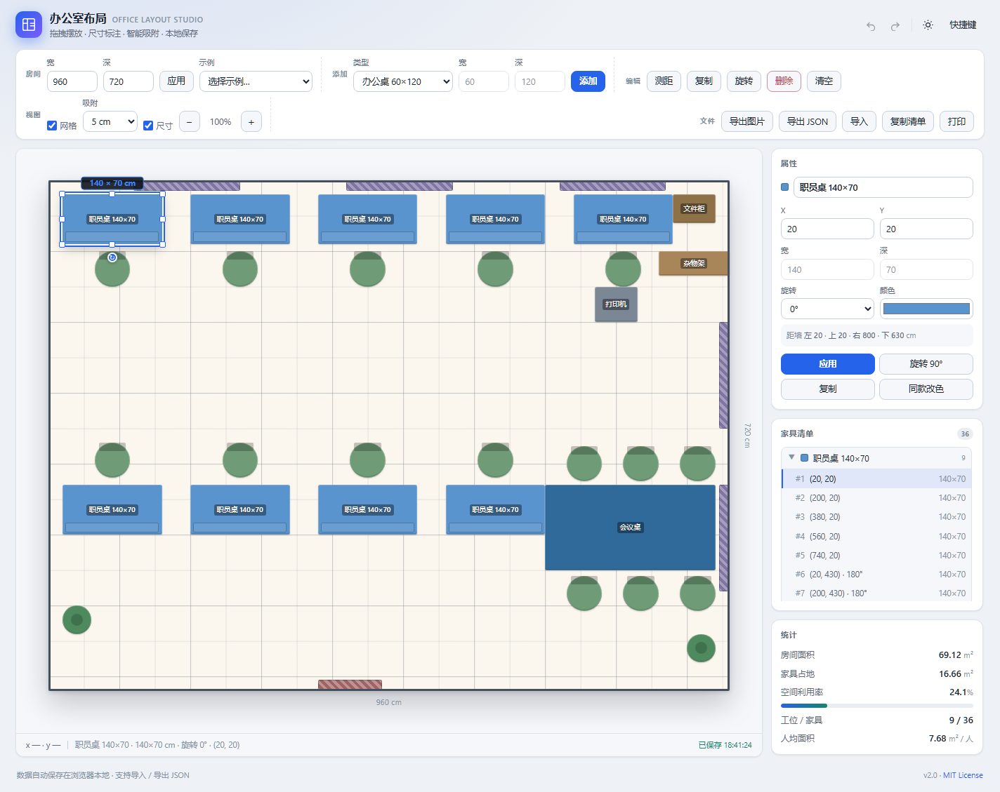
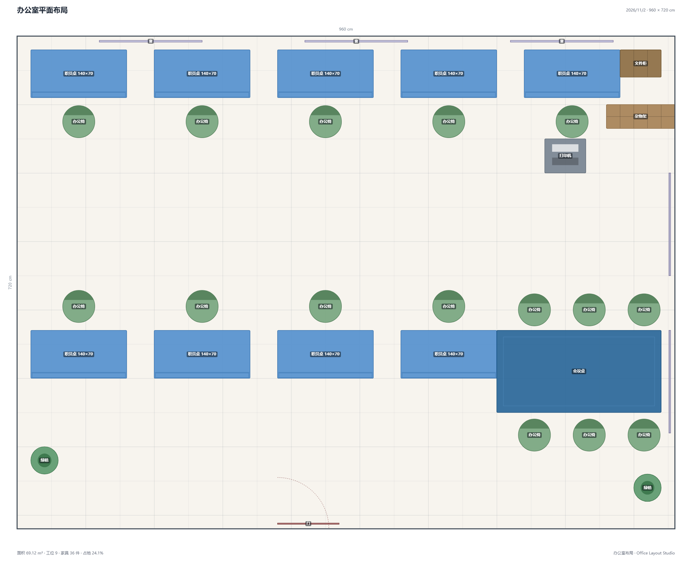

# 办公室布局 · Office Layout Studio

> 一个纯前端、零依赖的办公室平面布局工具：拖拽摆放、尺寸标注、智能吸附、撤销重做，支持导出 JSON 与高清图片。
> 双击 `index.html` 就能用，也可以直接部署到 GitHub Pages。




## 功能特性

- **拖拽布场**：按住家具拖动，靠近墙或其它家具时自动吸附对齐，并显示绿色参考线。
- **精确尺寸**：选中家具后显示宽深徽标与近墙净距；属性栏可精确输入 X / Y / 宽 / 深。
- **八向缩放**：拖动 8 个手柄调整尺寸；标准办公桌自动吸附到预设规格。
- **旋转与复制**：90° 旋转、`Ctrl+D` 复制、按住 `Ctrl` 拖动直接拖出新家具。
- **防重叠**：移动/缩放/旋转时自动避让，冲突就回退；导入旧布局后还能一键「整理重叠」。
- **撤销重做**：最多 80 步历史，`Ctrl+Z` / `Ctrl+Shift+Z`。
- **测距工具**：在画布上点两点测任意距离，`Esc` 退出。
- **家具库**：17 种预设（办公桌、工位椅、会议桌、沙发、文件柜、门窗、绿植、打印机……）和自定义尺寸。
- **清单与统计**：按同款分组、点击定位；实时统计面积、占地率、工位数、人均面积。
- **本地保存**：自动存进浏览器 `localStorage`，关掉页面再打开还在。
- **导入导出**：JSON 导入/导出、高清 PNG 导出、打印，以及一键复制家具清单。
- **示例布局**：开放办公区、六人小组、独立办公室，一键切换。
- **明暗主题**：跟随系统或手动切换，`?theme=light` 可指定主题。
- **响应式**：桌面三栏、平板/手机单栏，触屏可拖拽。

## 截图

| 深色主题 | 浅色主题 |
| --- | --- |
|  |  |

导出的 PNG 平面图（含标题、尺寸与统计页脚）：



## 快速开始

### 方式一：直接打开（最简单）

双击 `index.html`，或双击 `start.bat`。项目使用普通 `<script>` 而不是 ES Module，因此 `file://` 协议下也能正常运行。

> 如果双击没有反应，请右键 `start.bat` →「以管理员身份运行」，或直接把 `index.html` 拖进浏览器窗口。

### 方式二：本地服务器

```bash
npm run serve
# 打开 http://localhost:5173
```

### 方式三：GitHub Pages

1. 把仓库推到 GitHub。
2. 仓库 **Settings → Pages → Source** 选择 **GitHub Actions**。
3. 推送到 `main` 后，`.github/workflows/pages.yml` 会自动发布，地址形如 `https://<用户名>.github.io/<仓库名>/`。

## 使用说明

| 操作 | 说明 |
| --- | --- |
| 添加家具 | 顶部「类型」选择后点「添加」，或用示例布局起步 |
| 选中 | 点击画布中的家具；点空白处取消选中 |
| 移动 | 按住拖动；拖到墙边/家具边会自动吸附 |
| 缩放 | 选中后拖动白色手柄；带锁的桌子只会吸附到标准规格 |
| 旋转 | 拖家具下方的蓝色圆点、按 `R`，或 `Shift + 点击` |
| 复制 | `Ctrl+D`，或按住 `Ctrl` 拖动 |
| 删除 | `Delete` / `Backspace`，或工具栏「删除」 |
| 微调 | 方向键移动 5cm，`Shift + 方向键` 移动 1cm |
| 测距 | 按 `M` 或点「测距」，在画布上点两个点 |
| 缩放视图 | `+` / `-`，`0` 恢复 100% |
| 撤销 / 重做 | `Ctrl+Z` / `Ctrl+Shift+Z`（或 `Ctrl+Y`） |

### 文件与数据

- **自动保存**：每次修改后约 300ms 写入浏览器本地存储，状态栏会显示「已保存」时间。
- **导出 JSON**：把布局下载成 `.json`，可以备份或分享给同事。
- **导入**：点「导入」选择 JSON，或直接把 JSON 文件拖进画布。
- **导入兼容**：同时支持本项目的 v2 格式和旧版 `{ roomW, roomD, items }` 格式。
- **导出图片**：生成带标题、尺寸线与统计页脚的高清 PNG（白底，适合贴进文档）。
- **打印**：复用图片导出结果，在打印窗口里选择纸张与方向。

### JSON 数据格式

```json
{
  "app": "office-layout-studio",
  "version": 2,
  "roomW": 960,
  "roomD": 720,
  "items": [
    {
      "key": "desk_140x70",
      "type": "desk",
      "kind": "desk",
      "name": "职员桌 140×70",
      "w": 140,
      "d": 70,
      "x": 20,
      "y": 20,
      "rot": 0,
      "color": "#3f7cbf",
      "locked": true
    }
  ]
}
```

- 单位统一为 **厘米（cm）**，原点在房间左上角。
- `rot` 只支持 `0 / 90 / 180 / 270`；旋转 90° 后屏幕上的宽高互换。
- `door` / `window` 属于「构件」，不参与家具碰撞检测。
- 导入时会自动修正越界坐标、非法尺寸与旋转值。

## 技术实现

- 纯原生 **HTML + CSS + JavaScript**，无框架、无构建步骤、无运行时依赖。
- 家具用绝对定位的 DOM 渲染以获得顺滑的拖拽手感；导出时用同一套逻辑在 Canvas 重绘，保证「所见即所得」。
- 几何、状态、渲染、控制器分层，核心算法可脱离浏览器单元测试。

```text
.
├── index.html                 # 入口
├── assets/
│   ├── css/styles.css         # 主题、布局、家具样式、打印
│   ├── favicon.svg
│   └── js/
│       ├── geometry.js        # 包围盒、碰撞、吸附、找空位
│       ├── catalog.js         # 家具模板与颜色
│       ├── presets.js         # 内置示例布局
│       ├── store.js           # 撤销历史、本地存储、导入规范化
│       ├── renderer.js        # DOM / Canvas 绘制
│       └── app.js             # 主控制器与交互
├── tests/                     # 单元测试 + CDP 端到端测试
├── tools/                     # 语法检查、本地静态服务器
├── docs/                      # 截图
├── .github/workflows/         # CI 与 GitHub Pages
├── start.bat                  # Windows 双击启动
├── package.json
└── LICENSE
```

## 开发与测试

需要 Node.js 18+（仅用于开发脚本，运行页面本身不需要 Node）。

```bash
npm test          # 几何 / 历史 / 示例布局单元测试（32 个用例）
npm run lint      # 检查所有脚本语法
npm run test:e2e  # 启动本机 Chrome/Edge 做端到端冒烟测试（无浏览器时自动跳过）
npm run serve     # 本地预览
```

端到端测试会自动验证：页面初始化、示例渲染、添加/撤销/重做、鼠标拖动、PNG 导出画布、JSON 导入，以及控制台无报错。

生成 README 截图：

```bash
# Windows PowerShell
$env:SHOTS="1"; node tests/e2e.mjs
```

## 浏览器兼容

Chrome / Edge 111+、Firefox 113+、Safari 16.4+。使用了 CSS `color-mix()`、`structuredClone` 与原生 `<dialog>`。

## 已知限制

- 只支持矩形房间，暂不支持异形空间与多房间。
- 家具只支持 90° 步进旋转，暂不支持任意角度。
- 暂不支持框选多件家具（可按住 `Ctrl` 拖动快速复制）。

## License

[MIT](LICENSE) © 2026 2048sensei
